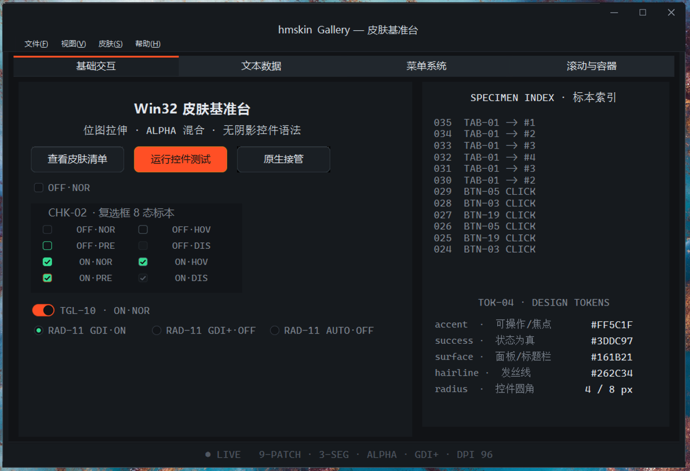

# hmskin

**把已有 Win32 应用的界面，整体替换为 DirectUI 自绘引擎**——不重写 UI 代码，
也不依赖原生控件渲染。

hmskin 结合了 Windows 界面史上两条互不相通的路线：

| | 传统换肤方案 | 主流 DirectUI 方案 | **hmskin** |
|---|---|---|---|
| 接管已有程序 | ✓ hook + 子类化，宿主零改造 | ✗ 必须用它的框架重写 UI | ✓ **hook 已有窗口，宿主零改造** |
| 控件渲染 | 皮肤位图模板，按标准控件类型逐一适配 | 完全自绘（无句柄逻辑控件） | ✓ **完全自绘**：keelobj 绘制树 + 控件状态机 |
| 皮肤形态 | 二进制皮肤文件，外观只读 | XML 布局 + 代码驱动 | ✓ **JSON manifest**：外观/布局/行为全声明式 |
| 控件行为 | 沿用系统控件逻辑 | 自绘控件类 | ✓ WMP 行为类 + 8 种事件回调 |

> 一句话：**换肤方案的接入成本，DirectUI 的渲染与行为自由度**——这是两类传统路线
> 都不具备的组合。宿主窗口的客户区被引擎变成一块 DirectUI 画布：原生控件被替换
> 为自绘控件树（按钮/复选框/开关/单选/Tab/滚动条/菜单/进度条…），连标题栏三钮、
> 根菜单栏与 `TrackPopupMenu` 弹出菜单一并接管；渲染后端三选一
> （GDI / GDI+ / Direct2D+DirectWrite）。

**宿主程序零配合**：你的代码照常调 `CreateWindow`、`TrackPopupMenu`、响应 `WM_COMMAND`，
hmskin 在引擎内部透明接管渲染与交互。



> 上图即 `demo/` 演示程序（零皮肤概念的原生代码写成）：标题栏、菜单栏、弹出菜单、
> 按钮矩阵、复选框/开关/单选、Tab、滚动条——全部由引擎自绘。

## 核心特色

### 透明接管（Transparent Takeover）

```cpp
// 宿主代码 —— 完全原生写法，零皮肤概念
case WM_RBUTTONDOWN:
    hMenu = ::CreatePopupMenu();
    ::InsertMenuItem( hMenu, IDM_ABOUT, FALSE, &mi );
    ::TrackPopupMenu( hMenu, TPM_LEFTALIGN, x, y, 0, hWnd, NULL );  // ← 被 hmskin 劫持
    break;

case WM_COMMAND:
    switch ( LOWORD(wParam) ) {
    case IDM_ABOUT:   // ← 选单按原生语义投递回来，现有 handler 无感工作
        ...
    }
```

调用 `hm_lib_enable_trackpopupmenu_hook(root, TRUE)` 后，原生 `TrackPopupMenu` 调用
被引擎接管并皮肤化，选单按 `PostMessage(WM_COMMAND, id)` 送回属主窗口。

### 声明式皮肤（JSON Manifest）

皮肤的全部定义——位图、布局、字体、色板、行为配置——在 JSON 里。
美术改皮肤不碰 C++、不改引擎重编译。

```json
"KeelObj": [
  {
    "idKeelObj": 3,
    "ParentKeelObjId": 12,
    "LayoutObj": {
      "LayoutDecoder": {
        "DecoderType": "hm_layoutdecoder_dock",
        "m_eDockType": "DOCK_TOP",
        "m_thickness": 34
      }
    },
    "WMP": [{ "id": 4, "RegEvts": [6] }]
  }
]
```

### 组合式控件（一份状态机，多种控件）

checkbox 的八态状态机 + 位图族 + 继承钩子 = 复选框 / 开关(Toggle) / 单选(Radio) 三种控件。
换肤只需换位图，行为引擎不变。

## 支持的控件

| 控件 | WMP 类 | 要点 |
|---|---|---|
| 按钮 | `hm_wmp_button` | 三态位图（normal/hover/press）+ 禁用态 |
| 复选框 | `hm_wmp_checkbox` | `setCheck()` 状态 API；八态状态机 |
| 开关(Toggle) | `hm_wmp_checkbox` 换肤 | 药丸位图族即开关，零引擎改动 |
| 单选(Radio) | `hm_wmp_radio` | 继承 checkbox；已选中点击不翻转；组语义由应用层驱动 |
| Tab 标签条 | `hm_wmp_tabheader` | 雪碧图三态 + 选中态；键盘 ←/→ 循环切换 |
| 滚动条 | `hm_wmp_scrollbar` | 值域 API；拖动/端钮/滚轮三路输入；容器内自动步进 |
| 根菜单栏 | `hm_wmp_rootmenu` | 标签直接读 HMENU（`GetMenuItemInfo`） |
| 弹出菜单 | `hm_wmp_popupmenu` | 引擎自建弹窗、自适尺寸、自绘条目；透明接管或主动调用 |
| 静态面/文本 | `hm_wmp_bkgnd` | 文字走 `setWMPDisplayText()` 实时刷新 |
| 非客户区 | `button_nca` / `bkgnd_nca` / `drawtrigger_nca` | 皮肤标题栏、边框、最小化/最大化/关闭三钮 |
| 进度条 | 纯 manifest 拼装 | 轨道 + 填充 dock 厚度即百分比，零引擎改动 |

## 可扩展架构

### 绘制引擎可插拔（DrawTool）

```
hm_ps_drawtool_i (抽象基类)
├── hm_ps_drawtool_gdi      ← GDI 后端
├── hm_ps_drawtool_gdiplus  ← GDI+ 后端（Release 默认）
└── hm_ps_drawtool_d2d      ← Direct2D + DirectWrite 后端（Debug 全启用）
```

manifest 里每个 WMP 声明 `"DrawTool": "D2D" / "Gdiplus" / "Gdi"`，换后端只改一个字符串；
宿主程序还可用 `demo.exe --drawtool D2D` 式参数在运行时整体覆盖（性能对比、环境适配）。

D2D 后端当前为混合形态（M1）：**文字绘制走 DirectWrite**（质量与 GDI+ 持平、
字形抗锯齿更现代），位图/纯色/文本测量转发 GDI+（布局度量零位移）。
位图路径的 D2D 原生化（M2）按 A/B 性能数据推进——实测 D2D 文字路径
每次绘制含 DC render target 往返（1394µs vs GDI+ 166µs），往返成本
是 M2 的头号设计约束，性能观测设施已常开（每次运行自动产出
`hmskin_perf.log`）。

### 皮肤加载器可插拔（Loader）

```
hm_wmp_loader_base (抽象基类)
├── hm_wmp_button_loader
├── hm_wmp_checkbox_loader
├── hm_wmp_radio_loader
├── hm_wmp_scrollbar_loader
├── hm_wmp_popupmenu_loader
├── ... ( 16 个控件加载器 )
└── hm_wmp_loader_depot     ← 按类名分发（"hm_wmp_button" → button_loader）
```

新增控件 = 新增一个 WMP 类 + 一个 loader + depot 注册一行。
`DECLARE_FACTORY` 宏自动生成工厂注册，manifest 按类名实例化。

### 布局系统（LayoutDecoder）

| 解码器 | 语义 | resize 时 |
|---|---|---|
| `corner` | 某角 + 定宽高 | 只跟角走，尺寸不变 |
| `dock` | 贴某边 + 定厚 | 厚度不变，其余贴满 |
| `offset` | 四边内缩 | 宽高随参考伸缩 |
| `clientarea` | = 宿主客户区 | 跟随（被接管的原生控件） |

写新解码器继承 `hm_layoutdecoder_i`，loader 注册即可。

### 绘制缓冲框架（hm_wmp_display 基类）

新控件继承 `hm_wmp_display`，只实现 `_render(hDC, rcCanvas)`（局部坐标系，
对"画到屏幕还是离屏"无感），交互处理器里一行 `drawSelf(pKeelObj, hwnd)`。
缓冲策略三档声明式：`BUF_NONE`（直画）/ `BUF_ALLOC`（点击级现建）/
`BUF_CACHE_SIZE`（拖动级按尺寸缓存）。

### DPI 感知

`hm_startup_param` 第三参 `uDpi`（默认 96）——manifest 按 96dpi 基准编写，
loader 在咽喉点自动缩放到物理像素。GDI+ 点制字体由 Graphics 真实 DPI 自动换算。

## 工作原理

```
hm_lib_startup( manifest )          ← 解析 JSON → 装配 keelobj 树 + WMP + 资源
    ↓
hm_wndpropid_connect( hWnd, id )    ← 把皮肤绑到已有 HWND
    ↓
Hook 拦截窗口消息                    ← WH_CALLWNDPROC / WH_MOUSE / API hook
    ↓
消息分发给各 WMP                     ← 按消息类型路由到控件处理器
    ↓
WMP 自绘替代默认渲染                 ← GDI/GDI+ 位图 + 文字 + 九宫格拉伸
    ↓
交互回调宿主( onHKSkinEvent )        ← 观察者模式，8 种事件
```

## 快速集成

```cpp
#include "hmskin.h"
#include "hmskin_event_listener_base.h"

// ① 实现事件监听器
class my_listener : public hmskin_event_listener_base {
    virtual void onHKSkinEvent( unsigned int uEventId, void* lParam1, void* lParam2 ) {
        // 8 种事件：BTN/CHK/RADIO/TAB/MENU-POP/MENU-BAR/SCROLLBAR/TRACKPOPUP
    }
};

// ② 启动引擎
my_listener listener;
hm_startup_param param( hInstance, &listener, 120 );  // 120 = 系统 DPI
hm_lib_startup( &param, _T("myapp.hm.manifest"), &g_pHMRoot );

// ③ 连接窗口
CreateWindow( ... );
hm_wndpropid_connect( g_pHMRoot, hWnd, 258 );

// ④（可选）启用透明菜单接管
hm_lib_enable_trackpopupmenu_hook( g_pHMRoot, TRUE );

// ⑤ 退出
hm_lib_shutdown( g_pHMRoot );
```

详细指南见 **`doc/INTEGRATION.md`**（五步接入 / manifest 速查 / WMP 清单 / 事件表 / 已知坑）。

## 构建

### 命令行（推荐 CI / 远程协作）

```
build.cmd Debug ARM64        ← 日常开发
build.cmd                    ← 全 6 配置
```

全量输出重定向到 `build.log`，任一失败 exit code 非零。详见 `doc/BUILDING.md`。

### Visual Studio

打开 `hmskin.sln`，配置矩阵 **{Win32, x64, ARM64} × {Debug, Release}**，直接生成。

### 前置

- Visual Studio 2026，工作负载 "Desktop development with C++"
- 组件 **"C++ ATL for v145 build tools"**（代码使用 `AtlConv.h`）
- Windows 10/11 SDK

### 冒烟测试

```
python tools\smoke_test.py --no-screenshot    ← manifest 校验 + 事件链
python tools\smoke_test.py                    ← + 金图容差比对
python tools\smoke_test.py --perf D2D         ← 渲染后端性能 A/B（滚轮场景）
python tools\smoke_test.py --perf Gdiplus
```

金图基线（`tools/golden/`）守护当前 D2D 渲染外观；`--perf` 模式自动
切后端跑滚轮场景，优雅退出后打印 `hmskin_perf.log`（count/avg/p50/p95/直方图）。

## 仓库结构

| 目录 | 说明 |
|---|---|
| `hmskin/` | 核心 DLL（hook × DirectUI 换肤引擎） |
| `demo/` | 集成示例（「基准台」Gallery：四章节控件标本 + 事件日志 + token 表） |
| `scrolldecorator/` | 独立自绘滚动条 DLL（可脱离 hmskin 单独使用） |
| `tools/` | `gen_skin.py` 位图生成器 + `smoke_test.py` 冒烟测试 |
| `doc/` | `INTEGRATION.md` 集成指南 + `BUILDING.md` 构建指南 + `img/` 截图 |
| `tools/golden/` | 金图回归基线（冒烟守护的渲染外观） |
| `DESIGN.md` | 设计系统（色板/字阶/布局/组件规范） |

## 平台与依赖

- **语言**：C++ (Win32 API + GDI/GDI+)，无 MFC 依赖
- **平台**：Win32 / x64 / **ARM64**（Windows 10/11 SDK）
- **工具集**：Visual Studio 2026 (v145)
- **依赖**：gdiplus + jsoncpp 1.9.6（源码已内置 `hmskin/dependence/json/`）

## 注意事项

- 部分源文件含 GBK 中文注释，请勿"以其他编码重新保存"
- `TreatWarningAsError` 关闭（历史告警 C4267/C4244/C4996 不影响功能）
- DPI Phase 1 已落（静态缩放）；Per-Monitor 动态换档属后续专项

## 项目历史

| 时间 | 事件 |
|---|---|
| 2016 | 初版：VS2008 起步，VS2013 v120_xp，仅 32 位，jsoncpp 0.5 预编译库 |
| 2026-10 | 现代化：VS2026 v145、三平台、jsoncpp 1.9.6 源码、UTF-8 manifest、指针宽度安全化、透明 TrackPopupMenu 接管、DPI Phase 1、脏区裁剪、绘制缓冲框架、冒烟测试基建、集成文档、**Direct2D/DirectWrite 文字后端（M1）+ 渲染性能 A/B 设施**、金图回归基线、装载时序根因修复 |
